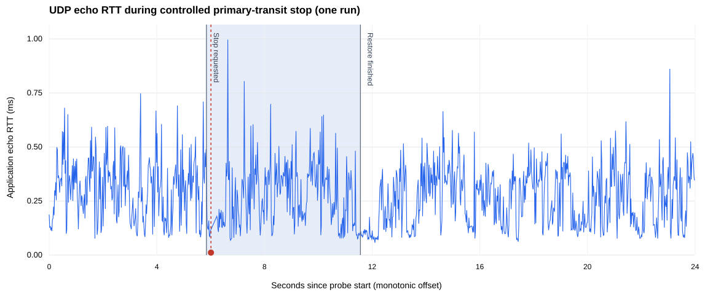

# NetPath Bench — Verified Field Experiment

Controlled BGP primary-transit stop · 2026-10-28 · one Windows 11 / Docker Desktop trial

**Source:** Original user-collected UDP echo JSON, per-probe CSV and orchestration events. Raw evidence is not bundled into the public release.

## Method and measurements

The C++ client in the FRRouting Edge network namespace sent sequential UDP echo requests to a server in the Core network namespace. The orchestration script stopped and restarted the primary transit router. The alternate BGP path was available, but this run does not independently timestamp BGP bestpath transitions.

| Observation | Value |
|---|---:|
| Attempts | 1,166 |
| Successful echoes | 1,165 |
| Missing application echo responses | 1 |
| Echo failure ratio | 0.0858% |
| Mean RTT | 0.274046 ms |
| p50 RTT | 0.272006 ms |
| p95 RTT | 0.498717 ms |
| p99 RTT | 0.649185 ms |
| p99.9 RTT | 0.861435 ms |
| Maximum successful RTT | 0.996557 ms |

## Approximate phase breakdown

| Phase | Attempts | Missing echoes | Mean RTT (ms) | p99 RTT (ms) |
|---|---:|---:|---:|---:|
| `pre_stop` | 286 | 0 | 0.307137 | 0.692003 |
| `stop_to_restore_finished` | 271 | 1 | 0.273319 | 0.698980 |
| `post_restore` | 609 | 0 | 0.258827 | 0.564690 |

## Individual unsuccessful probes

- Sequence **294** (`timeout`), approximately 168.100 ms after the Windows stop request; the next probe began 219.346 ms later. This gap includes the application timeout and is **not network downtime**.

## Data integrity

The analyzer verified the JSON/CSV counts, consecutive sequence numbering, valid sample statuses, timestamp ordering, the expected controlled-stop event sequence, and the source/destination identity.

| Source artifact | SHA-256 |
|---|---|
| `bgp-failover-udp.json` | `1ae338cbf7b4a5f509403ae15ae8c1e43d0e11a0ea66389649e8d64c6cae78b0` |
| `bgp-failover-udp.csv` | `b957c7bb5cbfe5a83acc9cdf8d45febd577bfddc3b205850c20cfde5fc1e30c8` |
| `bgp-failover-udp-events.json` | `f47fc29e3bdc892b34e82df511f74ab549f7b329ae69a3f8b488510efefc54e5` |

## Interpretation and limitations

The absence of one application echo occurs inside the approximate period of the primary-stop request. It is a temporal association, **not proof that BGP reconvergence caused packet loss**. The mean and tail RTTs are from a single run and are not stable production performance claims.

- RTT is a **userspace round trip**; no hardware timestamping or one-way latency measurement was performed.
- A timeout is **not proof of physical packet loss**. No packet capture or receiver-side loss counters were collected.
- Sample offsets are relative to the Linux client monotonic clock; event timestamps are Windows wall-clock values. Phase boundaries are **approximately** correlated.
- The study cannot estimate precise BGP protocol convergence, forwarding outage, or network loss duration.
- Single-run p99 and p99.9 should not be presented as statistically representative without repeated independent trials.

## Next evidence to collect

Repeat multiple *independent* baseline and failover runs with uniquely named artifacts. Pair with FRR route observations and, when possible, a receiver-side packet capture to distinguish missing application acknowledgments from link-level loss. Compare run-level summaries rather than combining them into one artificially large sample.
